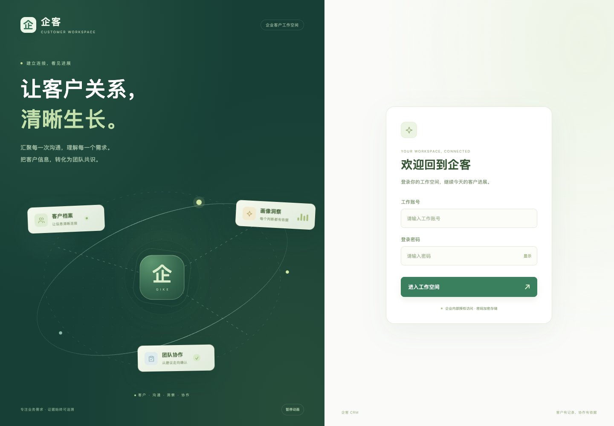
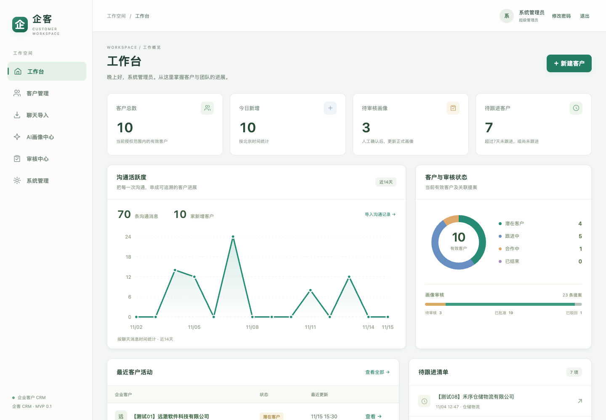
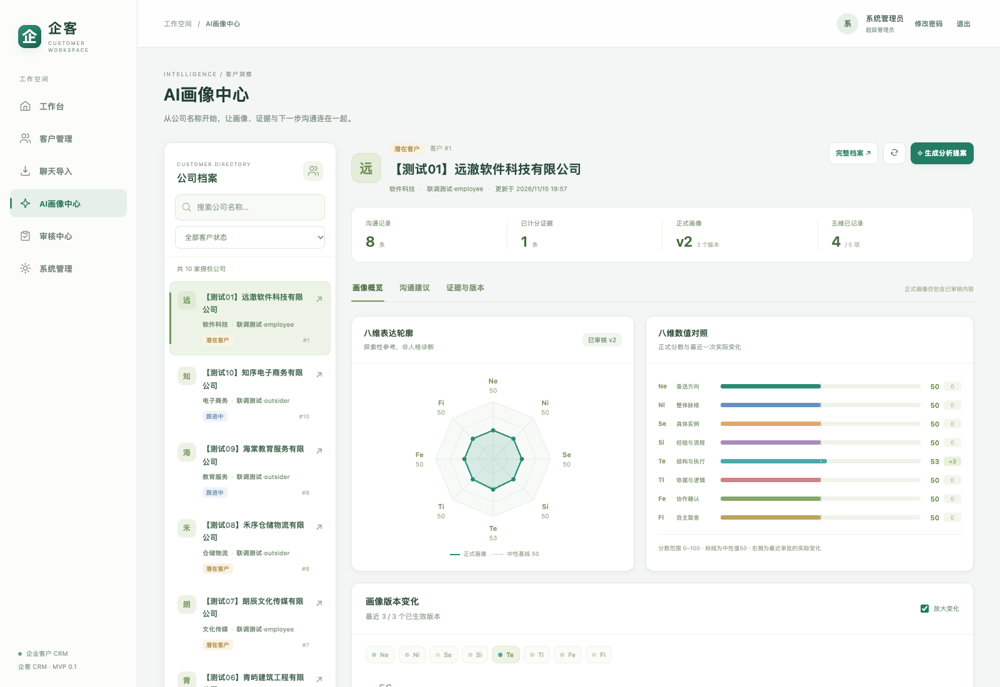

# 企客 企业客户智能 CRM MVP 0.1

适合小型财税服务公司的内网客户管理系统。后端 FastAPI、SQLAlchemy、SQLite，前端原生 HTML/CSS/JavaScript，无构建步骤或 CDN。提供完整的客户管理、聊天导入、画像分析、人工审批、版本恢复与审计流程。财务报表和税务申报数据不在系统范围内。

## 本地快速启动

要求 Python 3.11+。在终端进入本目录后执行：

```sh
python3.12 -m venv .venv
source .venv/bin/activate
python -m pip install -r requirements-lock.txt
cp .env.example .env
python scripts/manage.py init-admin
python run.py
```

若使用 uv：

```sh
uv venv --python 3.12
uv pip install --python .venv/bin/python -r requirements-lock.txt
cp .env.example .env
.venv/bin/python scripts/manage.py init-admin
.venv/bin/python run.py
```

初始化工具会交互要求设置至少 12 位的临时密码，也可从 `.env` 的 `ADMIN_PASSWORD` 读取。默认账号 `admin`；没有内置通用密码。初始化后从 `.env` 移除临时密码。已有超级管理员时不会重复创建。访问 http://127.0.0.1:8000，首次登录强制改密，改密后重新登录。已提供 macOS 的 `启动CRM.command`，会在缺少管理员时引导初始化。

本机如已创建 `.venv`，直接使用 `.venv/bin/python run.py` 即可。依赖锁文件记录本次实际通过测试的版本，`requirements.txt` 给出兼容范围。不会自动写入演示客户。

## 操作顺序

1. 系统管理 → 部门管理，创建业务部门；在账号与权限中创建员工，分配角色和客户范围。
2. 客户管理 → 新建客户，填写企业、联系人、授权联系方式、负责人和部门。超级管理员可配置额外授权账号，支持跨部门协作。
3. 客户详情 → 保存单条消息或批量粘贴；也可进入聊天导入，下载 Excel 模板，一次导入多个客户。
4. 检查逐行预览，修正格式不明确的行。点击确认后有效行入库；失败行可下载报告，修正后新建批次。系统按消息指纹去重，同一批次重复确认返回原结果。
5. 客户详情可勾选特定聊天证据后分析；未勾选时读取最近 100 条。也支持人工填写 JSON 提案。
6. 审核中心核对原文、五维字段差异、八维 delta 和理由；管理员可批准、驳回或修改后批准。普通员工和只读用户不能审核。
7. 批准后生成正式新版本。客户详情和画像中心可查看字段证据、更新时间、版本及分数变化。管理员可输入原因恢复历史版本，恢复会创建新版本。
8. 完整建议页面可查看需求摘要、推荐话术、避免话术、待确认问题、下一步建议，并反馈是否有用。

## 聊天导入格式

粘贴时每行一条，按北京时间解释：

```text
2026-11-15 09:30 客户: 请发服务费用明细。
2026-11-15 09:32 员工: 我整理后发给您确认。
```

Excel 表头必须为：`客户ID或企业名称`、`消息时间`、`说话人`、`消息内容`、`来源备注`。时间示例 `2026-11-15 09:30`，说话人为 `客户`/`员工` 或 `customer`/`employee`。企业同名时必须用 ID。每批最多 2000 行、文件不超过 5MB，解压后上限 40MB。公式不执行且作为错误行处理；请先粘贴为值。确认时填写的任何字段仍会重新校验，权限也会重新检查。

导出客户 Excel 中字符串按文本写入；错误报告 CSV 对危险公式前缀加引号。

## 角色和范围

| 角色 | 能力 |
|---|---|
| 超级管理员 | 管理全部客户、员工、部门、授权、设置、审计及审批 |
| 管理员 | 管理本部门客户、本部门员工/只读账号及授权客户的审批 |
| 普通员工 | 操作授权客户、导入消息、提交分析提案和建议反馈 |
| 只读用户 | 查看授权客户、消息、画像和提案；不可写入 |

范围有全部、本部门、本人负责、特定授权四种。默认员工仅本人负责，管理员必须为本部门。额外客户授权由超级管理员配置；它不会提升账号角色。例如只读账号被额外授权后仍不可写。

客户删除为归档，员工删除为停用并标记删除；保留消息、版本及审计。停用、改密、权限变更会撤销会话。账号负责人关系保留，删除员工前可先转移其客户。自身不能删除或降权。

## AI 配置

默认 `AI_MODE=mock`，不需要 Key，不向外部发送消息。Mock 提取明确关键词、标注为演示；对明确表达偏好可给小幅八维参考增量，无线索时为0，不假装调用真实 AI。

真实接口采用兼容 `/chat/completions` 的 JSON 协议：

```dotenv
AI_MODE=real
AI_BASE_URL=https://api.deepseek.com/v1
AI_MODEL=deepseek-chat
AI_API_KEY=在服务器设置真实密钥
```

更改后重启服务。超级管理员在系统设置填写数据处理规则、启用外部 AI；员工每次调用前还需确认授权与敏感内容检查。密钥只在服务器使用，不返回浏览器。请求只含客户 ID、当前五维画像、已审批八维分数和逐维说明以及消息内容，不提供联系人字段、联系方式字段或企业名称字段；已存客户名称、联系人、联系方式及常见手机号、邮箱、证件账号会被掩码。自由文本的敏感信息仍需人工检查。第三方服务商的数据保留、使用和网络策略由部署方在外发规则中明确。

真实响应按严格 Pydantic Schema 验证，未知字段、越界 delta、错误客户、伪造证据 ID 和无效 JSON 会报错，不修改正式画像。网络连接超时 10 秒，处理超时 90 秒，不自动重试以避免重复收费。初始交付使用模拟 HTTP 响应；后续已使用配置的真实模型验证，运行结果另存于测试报告。

八维分数初始 50、范围 0–100，人工 delta -10 到 10，AI自动建议限制为 -3 到 3；有效计分证据永久去重。新版逐维提案只对该维度的新原文计分，旧证据作为上下文不会阻止其他新证据计分。旧版没有逐维证据的手工提案继续采用保守去重。恢复历史不会删除已使用证据账本，避免撤销后重新累计。八维仅为探索性参考，非人格诊断，不能用于人格定型、购买能力/信用判断、敏感属性推断、差别定价和操纵性营销。

## 内网部署

默认 `HOST=127.0.0.1`，只允许本机访问。在 `.env` 设置服务器实际的私网 IP 与端口，例如 `HOST=192.168.1.20`。启动器拒绝 `0.0.0.0`、`::` 和公网 IP。该限制不能替代防火墙：部署方还需限制来源网段、禁止端口映射及公网反向代理。

建议使用公司 HTTPS 反向代理，并设置 `COOKIE_SECURE=true`。应用绑定明确私网或回环地址，不信任外部代理头，不启用跨域 CORS。会话为 HttpOnly、SameSite=Strict Cookie，写操作需同源标记与 CSRF Token。密码使用 Argon2，登录失败限流；会话默认 8 小时。SQLite 单进程已启用 WAL、外键与忙等待，适合小团队；不要通过网络文件系统共享数据库文件。

Linux 可使用 systemd：

```ini
[Unit]
Description=Qike CRM
After=network.target
[Service]
User=crm
WorkingDirectory=/opt/crm_mvp
EnvironmentFile=/opt/crm_mvp/.env
ExecStart=/opt/crm_mvp/.venv/bin/python run.py
Restart=on-failure
UMask=0077
[Install]
WantedBy=multi-user.target
```

将 `.env`、`data/`、备份目录限制为服务账号可访问。默认数据位于 `data/crm.sqlite3`。不要使用 `uvicorn --host 0.0.0.0` 绕过启动器。系统不自动检测网络边界，实际内网防火墙和 HTTPS 需在目标环境验收。

## 管理与备份恢复

```sh
# 交互重置密码，下次登录强制修改，撤销旧会话
.venv/bin/python scripts/manage.py reset-password 员工账号

# 在线一致性备份，可含 WAL 中的最新提交；目标文件必须不存在
.venv/bin/python scripts/manage.py backup backups/crm-2026-11-15.sqlite3

# 先停止服务。恢复覆盖现有数据库，应先备份当前数据
.venv/bin/python scripts/manage.py restore backups/crm-2026-11-15.sqlite3 --confirm-stopped
```

恢复工具先验证 SQLite 完整性及核心表，再恢复并撤销所有会话，记录恢复审计。备份本身同样包含客户数据，应按公司规则加密保存并定期演练。密钥及 `.env` 不在数据库备份中，需独立保管。备份/恢复命令当前仅支持 SQLite。

## 开发与验收

```sh
uv pip install --python .venv/bin/python -r requirements-dev.txt
.venv/bin/python -m pytest -q
```

接口定义：`/openapi.json`；离线可读接口文档：`/docs`；健康检查：`/health`。需要客户端直接调用写接口时，先 POST `/api/auth/login`，携带 `X-CRM-Request: 1`，保存 Cookie；登录返回 `csrf_token`，之后的写请求加 `X-CSRF-Token`。首次改密前仅允许认证相关接口。

需求决策、ER 关系、API 分类、页面结构见 [架构说明](docs/architecture.md)，测试范围及运行结果见 [验收记录](docs/acceptance.md)。本版本使用建表初始化，不含跨历史版本的自动数据库迁移；未来更改已有数据库结构必须先备份并编写显式迁移。


## macOS 局域网常驻运行

`scripts/serve_lan.py` 每3秒检测 `.env` 的 `LAN_INTERFACE`（默认 en0），只接受明确的 RFC1918 私网 IPv4，在地址变化时更新 HOST 并重启子服务，断网时停止子服务等待恢复。

`deploy/com.qike.crm-mvp.plist` 是 LaunchAgent 模板。先创建 `.venv`、配置 `.env` 并初始化管理员，再将模板中的所有 `/ABSOLUTE/PATH/TO/hk` 替换为当前仓库的绝对路径，复制到 `~/Library/LaunchAgents/` 后执行：

```sh
launchctl bootstrap gui/$(id -u) ~/Library/LaunchAgents/com.qike.crm-mvp.plist
launchctl kickstart gui/$(id -u)/com.qike.crm-mvp
```

模板日志目录为项目 `data/`；初始化管理员会创建该目录。跨设备访问需在使用方网络验证路由、客户端隔离与防火墙。源码不附带任何已配置的本机实例、数据库、账号密码或密钥。


## 八维表达参考更新

新版提案包含 `jungian_analysis`（八个维度的原文、理由、置信度和表达建议）、`jungian_guidance`（这些维度如何参与推荐话术）以及后端生成的 `jungian_context`（正式分数、有效delta、预览分数、被排除的旧证据）。无有效线索的维度保持不变，非零增量不能引用员工发言或伪造引文。

客户详情、画像中心和审核页均展示八维参与说明；审核页可逐维展开原文，查看审批前后预计分数。审批后逐维说明写入画像元数据和版本快照，历史数据无需物理表迁移。旧提案不回写，重新分析生成新提案。

DeepSeek结构化提取请求显式禁用默认思考模式，并为完整JSON保留输出预算；检测到长度截断时拒绝写入。依据官方文档：[Thinking Mode](https://api-docs.deepseek.com/guides/thinking_mode/) 和 [JSON Output](https://api-docs.deepseek.com/guides/json_mode/)。这不改变人工审批、证据去重和客户边界优先的规则。


## 界面与可视化更新（2026-11-15）

工作台提供14天沟通趋势、客户状态环图和审批分布；所有统计遵循当前用户客户范围，按北京时间归日。AI画像中心提供公司名称搜索、状态筛选、每页8家分页、画像/建议/证据标签页，以及正式八维雷达、数值增量和历史曲线。曲线可选择维度并切换完整刻度或明确标注的局部刻度。

登录页采用原生CSS轨道与浮动卡片动画，提供暂停按钮，支持系统减少动态效果。页面进场、统计数字、骨架屏和表单提交状态均有反馈；手机采用收起导航及紧凑公司目录。无需安装前端依赖或连接CDN。

`GET /api/dashboard` 增加授权范围内的 `charts`；`GET /api/customers/{id}/insights` 提供沟通、计分证据、提案状态和最近30个正式版本，仅允许已授权客户。新增接口不修改画像和历史。

本轮完整回归59项通过，并完成真实浏览器登录、搜索、图表切换及手机布局检查。验证范围见 [验收记录](docs/acceptance.md)。


## 界面预览







截图来自开发验收环境，所示客户为合成测试数据；源码启动后为空数据库，需自行创建账号与客户。

## 开源协议

本项目采用 [MIT License](LICENSE)，Copyright (c) 2026 ikun441。
