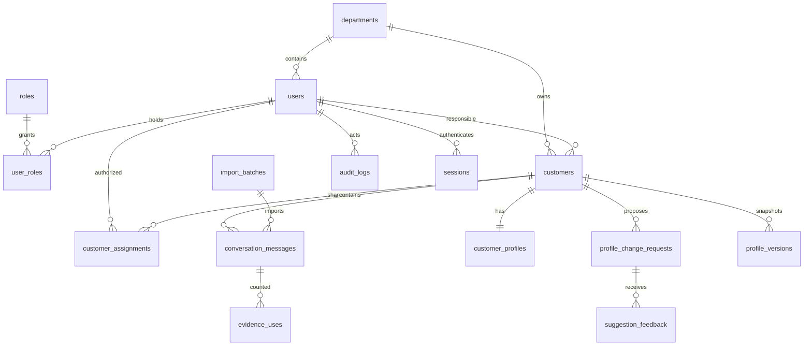

# 企业客户 CRM MVP 设计

原生 HTML/CSS/JavaScript 通过同源 Fetch 调用 FastAPI。FastAPI 使用同步 SQLAlchemy 事务访问 SQLite；AI 和导入处理为独立服务。前端无需构建，无 CDN 依赖。开发顺序为认证和客户、导入、画像审批、验收与部署。

## 需求缺口与采用规则

- 内网不等于认证可信：服务端每个客户相关接口检查范围，禁止客户端指定任意角色或归属绕过限制。
- 默认管理员管理本部门员工和客户，可审批；超级管理员管理全局。员工可写授权客户，只读角色仅查看。跨部门授权由超级管理员配置。角色与范围分开保存。
- 密码最短 12 位；初始化和重置必须从环境变量或交互读取，强制首次修改。账号删除为禁用并标记删除以保留审计。
- 客户归档代替物理删除；企业名称允许同名，Excel 同名歧义报错，优先客户 ID。
- 导入按有效行部分成功，错误行明确提示。批次由服务器保存，确认时重新校验客户权限。消息指纹包括客户、时间、说话人、正文；唯一约束实现跨批次去重。
- 粘贴使用 YYYY-MM-DD HH:MM 客户/员工: 正文。不明确行留待人工修正，禁止自动补时间或猜说话人。
- 八维中性分数 50，范围 0–100，单次 delta -10 至 10。同一消息证据在某客户计分一次，新版按维度引用的原文排除已计分证据，新增证据仍可计分；旧版汇总提案继续保守去重。AI自动建议限制为±3。
- 五维字段更新是替换语义，空数组表示清空。每个修改字段保存证据、更新时间、来源；所有提案必须提供该客户真实消息，人工输入同样审核。
- 画像采用乐观版本检查及条件 UPDATE；审批和恢复创建新版本，历史不覆盖，恢复不删除证据使用账本。
- AI 输出不可信，严格 Schema 校验、证据归属校验。Mock 仅为标明的演示，不声称真实模型结论。真实服务需配置 HTTPS 地址、密钥、模型并启用外发规则；每次调用需确认客户已获授权。外发只提供当前五维画像及脱敏聊天，包含已审批八维表达参考，排除联系人和联系方式；自动掩码不能替代人工检查。
- 待跟进定义为未归档且七天未跟进；系统按 Asia/Shanghai 显示时间，内部规范化为 UTC。
- 服务默认 127.0.0.1，不开放公网。上线内网需要运维指定私网地址和防火墙；HTTPS 下启用 Secure Cookie。

## 数据关系

使用外键、消息指纹唯一索引、客户及消息时间索引、画像客户唯一键、客户版本联合唯一键。每个历史快照保存实际八维 score_delta，包括版本恢复操作。JSON 用于提案、画像快照及字段元数据；角色、授权、消息和审计为独立关系表。PostgreSQL 迁移需安装驱动，改 DATABASE_URL，并针对实际部署执行迁移与回归测试；当前 CLI 备份恢复仅适配 SQLite。

## 页面与 API

六个一级页面：工作台、客户管理、聊天导入、AI画像中心、审核中心、系统管理。客户详情三栏，窄屏标签切换。系统管理展示账号、部门、归属、审计、AI配置状态及系统设置。

API 由 /docs 和 /openapi.json 给出精确 Schema；主要路由：

| 模块 | 路由 |
|---|---|
| 认证 | POST /api/auth/login、logout、password；GET /api/auth/me |
| 客户 | GET/POST /api/customers；GET/PUT/DELETE /api/customers/{id} |
| 消息 | GET/POST /api/customers/{id}/messages |
| 导入 | GET /api/imports/template；POST /api/imports/text、excel、{id}/confirm；GET /api/imports/{id} |
| 画像 | GET /api/customers/{id}/profile、versions；POST /api/customers/{id}/analyze、restore |
| 审核 | GET /api/requests；GET /api/requests/{id}；POST /api/requests/{id}/review、feedback |
| 管理 | GET/POST /api/admin/users、departments；PUT/DELETE /api/admin/users/{id}；PUT/DELETE /api/admin/departments/{id} |
| 设置 | GET/PUT /api/admin/settings；GET /api/admin/audits；GET /api/dashboard |

## 参考实现资料

- FastAPI 响应 Cookie：https://fastapi.tiangolo.com/advanced/response-cookies/
- SQLAlchemy 乐观版本：https://docs.sqlalchemy.org/en/20/orm/versioning.html
